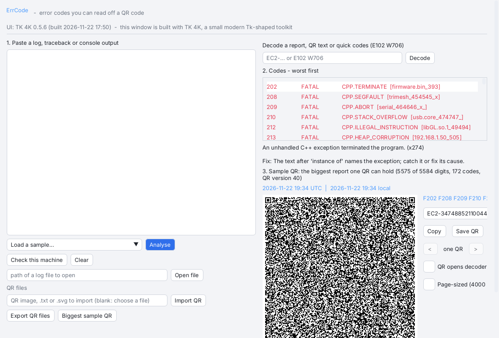
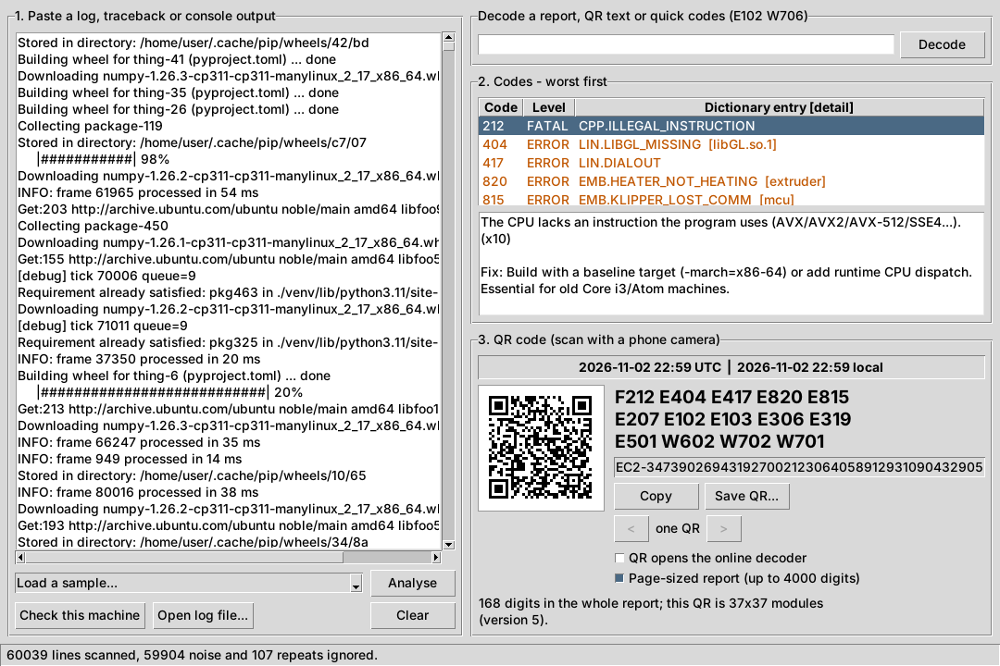
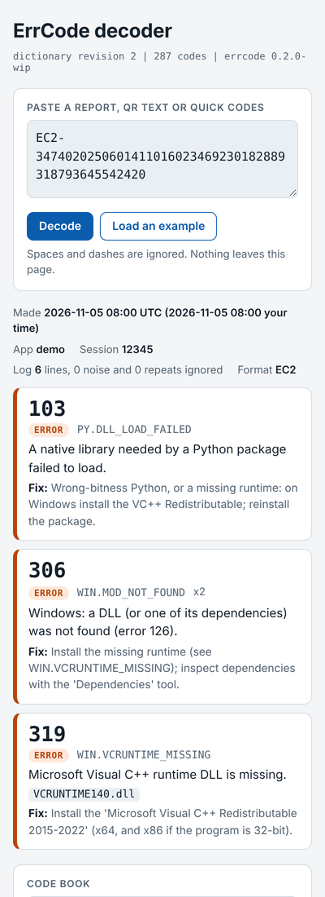
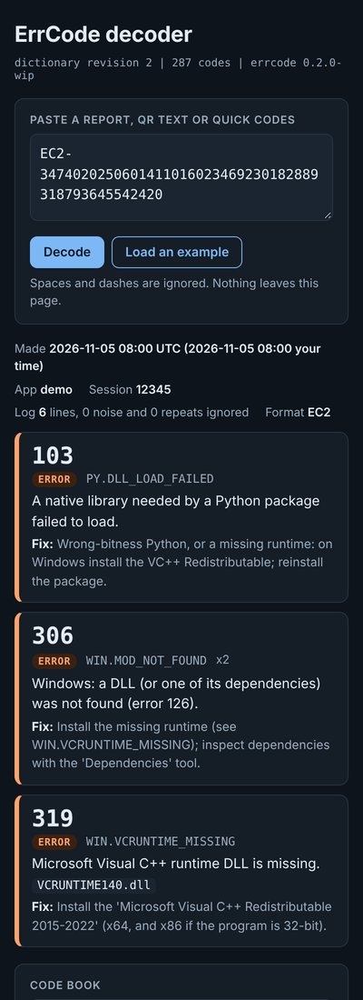
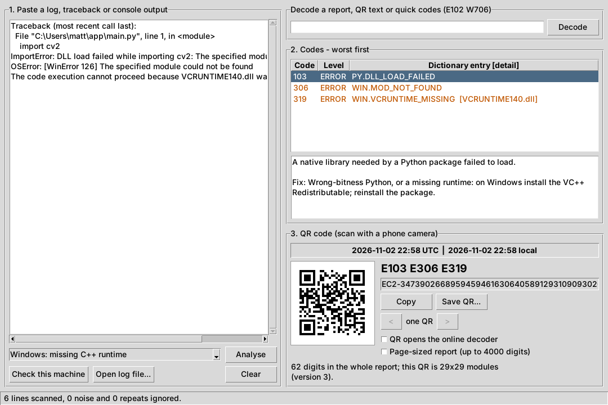
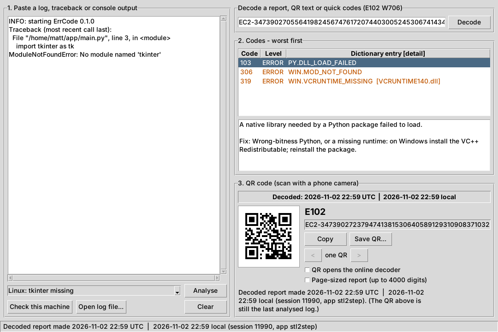
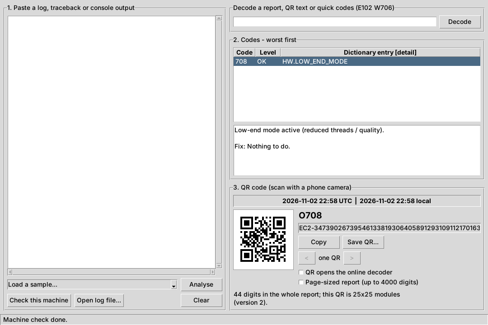
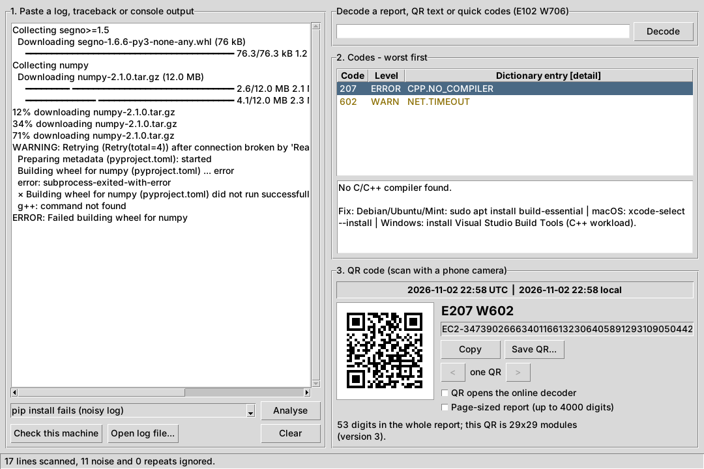

ErrCode is a **drop-in plugin for Python programs** that turns "something went wrong" into short **3-digit codes**
you can read off a phone camera, say on the phone, or type into a web page. One line in your program
(`errcode.install()`) records crashes, warnings and failed commands, ranks them from fatal down to harmless,
ignores noise like "12% downloading", and prints a compact report such as:

> **WORK IN PROGRESS: MANY FEATURES MAY BE BROKEN** (`0.3.3-wip`, proof of concept)
>
> **Built with an experimental UI toolkit:** the window is made with [TK 4K](https://github.com/The-Dorkknight/tk4k) 0.5.6, an *experimental* work-in-progress Python GUI toolkit, so expect rough edges in the window. The plugin itself (`errcode.install()`) does not depend on it. The TK 4K paper is included in this repo: [docs/TK4K-paper.pdf](docs/TK4K-paper.pdf).

# ErrCode

> **UI: [TK 4K](https://github.com/The-Dorkknight/tk4k)** (experimental, paper: [docs/TK4K-paper.pdf](docs/TK4K-paper.pdf)) - the ErrCode window is built with TK 4K, a small, modern, Tk-shaped
> Python GUI toolkit (SDL3 + Dear ImGui). It is also the practical test of that toolkit. The title bar, the header and
> the README say so on purpose. 

**Source-available · Non-commercial.** Copyright Matthew Armstrong. Licensed under the
[PolyForm Noncommercial License 1.0.0](LICENSE.md): you may use and modify it for non-commercial purposes;
commercial use needs separate permission. Provided as is, with **no warranty and no liability**. This is
source-available software, not OSI "open source". Not legal advice.

```
E102 W706 W602  EC2-34739026849376627710778795763564242769252885287944249844
```

`E102` means "error 102: Python's tkinter is missing". The long `EC2-` string is the whole report as digits: every
code, how often it happened, details such as the missing module's name, the app and the time. It fits a small QR
code. The built-in dictionary has **287 entries** for Python, C/C++, Windows, Linux, macOS, network,
hardware/GPU and **embedded boards and 3D printers** (ESP32, STM32, RP2040, Klipper, Marlin).
A small demonstration window is included, **built with TK 4K** (a tkinter version remains as the fallback); the plugin is the product.
The window opens on a **sample QR with the most one QR can hold** (a real, decodable report: 5,575 of the 5,584 digits a
version-40, 177 x 177 QR takes). **Export QR files** writes each QR part as PNG and SVG plus `report.txt`
(the report text is embedded in the files); **Import QR** reads those back, a text file, or with OpenCV installed
(`pip install opencv-python-headless`) a photo or screenshot of an ErrCode QR. Multi-part reports can be imported one part at a time.
Not tested on Windows/macOS or with a phone camera; scan the exported PNG at full size rather than the on-screen QR.



## Contents
[Quick start](#quick-start) · [Usage](#usage) · [Codes and reports](#codes-and-reports) ·
[Add it to another project](#add-it-to-another-project) · [The dictionary](#the-dictionary) ·
[Ranking and noise](#ranking-and-noise) · [Phone decoder](#phone-decoder) · [Demo window tour](#demo-window-tour) ·
[How small is it?](#how-small-is-it) · [Low-end hardware](#low-end-hardware) · [Requirements](#requirements) ·
[Troubleshooting](#troubleshooting) · [What exists and what does not](#what-exists-and-what-does-not) ·
[Known limitations](#known-limitations)

## Quick start

Unzip, then run the one-step launcher. It creates a private virtual environment, installs the QR dependency and
the package itself, and opens the demo window.

| System | Command |
|---|---|
| Linux / macOS | `./run.sh` |
| Windows | double-click `run.bat` |

No GUI? The plugin and command line need no extra system packages:

```
python3 -m venv .venv && . .venv/bin/activate && pip install -r requirements.txt
python -m errcode scan --sample 1          # try a built-in sample log
```

## Usage

### 1. As a plugin (the main way)

```python
import errcode
errcode.install(app="myprog")      # hooks uncaught exceptions, threads and logging; prints one footer at exit
```

Real output (traceback lines omitted, the long `fix:` line shortened) from
[`examples/plugin_demo.py`](examples/plugin_demo.py), a program that logs a timeout warning, records "no GPU" and
then fails to import tkinter:

```
ModuleNotFoundError: No module named 'tkinter'
[errcode plugin_demo] E102 W706 W602  EC2-34739026849376627710778795763564242769252885287944249844
[errcode plugin_demo]   102  ERROR PY.TK_MISSING              Python's Tk GUI toolkit (tkinter) is not installed.
[errcode plugin_demo]   706  WARN  HW.GPU_FALLBACK            No usable GPU - running on the CPU path (slower, fully functional).
[errcode plugin_demo]   602  WARN  NET.TIMEOUT                The network operation timed out.
[errcode plugin_demo]   fix: Debian/Ubuntu/Mint: sudo apt install python3-tk | Fedora: ...
```

Other calls, all optional:

```python
errcode.record("HW.GPU_FALLBACK")                 # app-set code, e.g. "no GPU, using the CPU path"
errcode.record("PY.MODULE_MISSING", detail="open3d")   # with a detail that travels in the report
errcode.define_app(1, "NO_SCANNER", errcode.table.ERROR, "Scanner not detected")   # your own code 901
cp = errcode.run(["cmake", "--build", "."])       # like subprocess.run; output + exit code are analysed
rep = errcode.report()                            # the ranked Report so far
rep.quick                                         # "E102 W706 W602"
rep.payload                                       # "EC2-3473902684..."  (the whole report, digits)
rep.parts()                                       # QR-sized pieces (one, unless the report is big)
rep.text()                                        # readable listing with fix hints and the digits in blocks
rep.save_qr("report.png")                         # or .svg  (needs the optional 'segno' package)
rep.save_qr("report.png", link=True)              # QR opens the online decoder page instead
errcode.scan(open("run.log").read())              # analyse any log text without installing hooks
errcode.decode("EC2-3473902684...")               # the other end: digits -> meaning (EC1 strings too)
errcode.decode("E102 W706")                       # quick codes
```

`install()` never raises into your program. `ERRCODE_QUIET=1` silences the footer. `errcode.uninstall()` undoes
it. `errcode.install(qr=True)` also prints a block-character QR in the terminal.

### 2. Command line

```
python -m errcode scan run.log --qr          # ranked report + QR in the terminal (exit status 1 if something failed)
python -m errcode scan run.log --png r.png   # save the QR (r-1.png, r-2.png ... if it needs several)
python -m errcode scan run.log --page        # allow a page-sized report (up to 4000 digits, up to 5 QR parts)
python -m errcode scan run.log --link        # QR opens the decoder web page directly
python -m errcode decode EC2-34739 02684 ... # spaces are fine; several QR parts can be given in any order
python -m errcode decode E102 W706           # quick codes; v0.1 EC1 strings and 4-character codes still work
python -m errcode list EMB                   # one area of the dictionary (GEN PY CPP WIN LIN MAC NET HW EMB)
python -m errcode bench [your.log ...]       # compare raw / zlib / EC2 sizes
python -m errcode decoder decode.html        # write the offline decoder page
python -m errcode export dictionary.json     # whole dictionary + word list as JSON
python -m errcode --version
```

### 3. Demo window

`./run.sh` / `run.bat`, or `python src/main.py`. See the [tour](#demo-window-tour).

## Codes and reports

**3-digit codes**, grouped like HTTP status codes:

| | | | |
|---|---|---|---|
| `0xx` general / portable OS (`000` = all ok) | `1xx` Python | `2xx` C / C++ and builds | `3xx` Windows |
| `4xx` Linux | `5xx` macOS | `6xx` network | `7xx` hardware, GPU, USB, serial |
| `8xx` embedded boards, firmware, 3D printers | `9xx` your program's own codes | | |

**Quick codes** add a severity letter: `F` fatal, `E` error, `W` warn, `O` ok. `F212 E417` reads "fatal 212,
error 417".

**The EC2 report** carries everything as digits, in 20-digit blocks:

```
EC2-
34739 02684 93766 27710      <- block 1: 19 digits of data + 1 check digit
77879 57635 64242 76925      <- block 2
28852 87944 249844           <- last block: only as long as it needs
```

Inside are: the time (to the minute, UTC), a session number, the app name, the log statistics, and for each
event its code, severity, count and detail (`[pyrealsense2]`, `[libGL.so.1]`, `[mcu]`, an exit code...). Each
block's check digit catches any single wrong digit or swapped pair, and the decoder names the block to re-read.
In a QR code the digits use numeric mode, which packs them as tightly as letters or bytes would be packed.
Big reports split into numbered QR parts (`EC2/13708-...`) that can be scanned in any order.
Format details: [HOW_IT_WORKS.md](HOW_IT_WORKS.md). Why digits: [RESEARCH.md](RESEARCH.md).

## Add it to another project

**Python program** (one line in `requirements.txt`, two in your code):

```
# requirements.txt
errcode @ git+https://github.com/The-Dorkknight/errcode@v0.2.0-wip
```

```python
try:
    import errcode
    errcode.install(app="stl2step")          # use your app's name
except ImportError:                          # the program still runs without it
    errcode = None
```

Then, where your program knows something specific, record it:

```python
if not gpu_ok and errcode:
    errcode.record("HW.GPU_FALLBACK")
```

**C / C++ / ESP32 / RP2040 firmware:** copy [`c/errcode_ec2.h`](c/errcode_ec2.h) into the project (one header,
no malloc). [`c/example.c`](c/example.c) shows a board reporting `815 EMB.KLIPPER_LOST_COMM [mcu]` and a
brown-out. Print the `EC2-...` line on the serial port or a display, or feed it to a QR library on the device.

**A program that only writes logs:** run `python -m errcode scan its.log --qr` afterwards.

## The dictionary

287 entries, 680 recognition patterns. Each entry has a fixed 3-digit code, a plain-language meaning, a suggested
fix and the text patterns that recognise it. Portable OS errors (`ENOENT`, `ENOSPC`...) are also matched from
exception `errno`/`WinError` numbers, and process exit codes (137, 139, `0xC0000135`...) are mapped too.

| Area | Entries | Examples |
|---|---:|---|
| `0xx` General / portable OS | 40 | `019` disk full, `017` permission denied, `038` file too large for FAT32 |
| `1xx` Python | 47 | `102` tkinter missing, `129` NumPy 2 ABI mismatch, `146` wrong `serial` package |
| `2xx` C / C++ | 29 | `208` segfault, `212` illegal instruction (AVX on an old CPU), `219` compiler killed (out of RAM) |
| `3xx` Windows | 47 | `319` VC++ runtime missing, `335` USB device stopped responding, `347` Device Manager code 43 |
| `4xx` Linux | 30 | `417` not in the `dialout` group, `418` brltty grabbed the CH340, `429` immutable OS |
| `5xx` macOS | 19 | `501` Gatekeeper, `506` Intel vs Apple Silicon, `516` driver extension blocked |
| `6xx` Network | 24 | `603` DNS, `618` `.local` name not found, `619` WebSocket (Moonraker) failed |
| `7xx` Hardware / GPU | 23 | `706` GPU fallback, `713` Pi under-voltage, `720` RealSense not found |
| `8xx` Embedded / printers | 28 | `801` esptool cannot connect, `803` ESP32 brown-out, `815` Klipper lost the MCU, `826` thermal runaway |

Browse it with `python -m errcode list`, or in the code book of the [phone decoder](#phone-decoder). The messages
and fixes were written from general knowledge of these failures; they have **not** each been reproduced on real
machines (see [limitations](#known-limitations)). Adding entries is the easiest way to contribute: see
[CONTRIBUTING.md](CONTRIBUTING.md).

## Ranking and noise

* **Ignored as noise:** progress percentages, progress bars, download sizes and speeds, ETA, routine
  `INFO`/`DEBUG` lines, package-manager chatter (`Collecting…`, `Downloading…`), timestamp-only lines and lines
  with no letters or digits. A line that *also* contains a failure word is never dropped, so
  `Download failed at 12%` is kept.
* **Repeats collapse:** 2,000 identical retry lines count once, with a count of 2,000.
* **Ranked:** fatal, then error, then warn, then ok. Ties go to whatever appeared first (root causes usually come
  before the cascade). Lines labelled `WARNING:` and `log.warning()` records are capped at warn.
* **Discarded:** wrapper symptoms (like a bare traceback) when a specific cause was found, and "ok/info" whenever
  anything failed. A completely clean log reports `000`.
* **Space limit:** if a report would be longer than its budget (one QR by default), long details are shortened,
  then the lowest-ranked codes are left out and counted ("+5 lower-priority code(s) left out to fit 960 digits").

## Phone decoder

[`docs/decode.html`](docs/decode.html) is a single offline web page with the whole dictionary inside. Paste a
report, several QR parts, or quick codes; it shows each code's meaning, detail and fix, and when the report was
made in UTC and your own time. It also has a searchable code book. Once GitHub Pages is switched on, a QR made
with `--link` opens it directly from the phone camera, with the report after `#`. Nothing is sent anywhere.

| Light | Dark |
|---|---|
|  |  |

## Demo window tour

| | |
|---|---|
|  | **Paste a log** (or pick a built-in sample, or open a log file) and press *Analyse*. Codes are listed worst first, coloured by level, with their details; select one for its meaning and fix. A **time and date bar** above the QR shows when the report was made (UTC and your local time). The quick codes and the QR appear bottom right. |
|  | A 60,000-line log: 59,904 noise lines and 107 repeats ignored, 13 codes left, 168 digits, one 37×37 QR. Tick *Page-sized report* to allow up to 4,000 digits; big reports show *QR part 1 of N* with arrows. *QR opens the online decoder* puts the decoder link in the QR. |
|  | **Decode** a report, QR text or quick codes typed from a phone screen. A wrong digit is caught by the block's check digit. |
|  | **Check this machine** runs a quick probe and reports app-set codes: low RAM, low-end mode (2 or fewer CPU cores or under 2 GB RAM), missing QR package. |
|  | A noisy `pip` log: the real cause (no compiler) is ranked above a recovered timeout. |

The window title and status bar show the version, build time and launch time, so a screenshot says which build
you ran. Screenshots were taken from the real GUI on a virtual display in a Linux sandbox, with the built-in
sample logs and a generated log (not real failures on a real machine).

## How small is it?

Measured with `errcode bench` (bytes, except EC2 in digits; QR = symbol version at error level M):

| Log | Raw | zlib | **EC2** | QR for raw text | **QR for EC2** |
|---|---:|---:|---:|---:|---:|
| Noisy pip install, 17 lines | 1,108 B | 410 B | 31 digits | version 27 | version 2 (25×25) |
| tkinter missing, 5 lines | 189 B | 152 B | 25 digits | version 10 | version 2 |
| Generated 20,000-line log | 1,022,192 B | 110,970 B | 108 digits | does not fit | version 4 (33×33) |

A printed page holds about 4,000 digits, enough for about 140-200 codes with details. The trade-off: the report
carries dictionary codes and short details, not the original text. See [RESEARCH.md](RESEARCH.md).

## Low-end hardware

The project aims to run on a 7th-generation Core i3-class machine. The library is pure Python (standard library
only; the optional QR package is pure Python as well, no Pillow, no numpy, no GPU), and the demo window uses
plain tkinter. Measured in a Linux sandbox (**not** on an actual i3): a generated 102,000-line log scanned in
about 1.5 s with a peak of about 35 MB of RAM for the whole Python process. The C encoder needs no heap; its example program is about 6 KB on
x86-64 Linux (not measured on a microcontroller yet).

## Requirements

* Python 3.8 or newer (the code parses as 3.8; it has been *run* on 3.11, 3.12 and 3.13 only).
* Optional: [`segno`](https://pypi.org/project/segno/) for QR images (`pip install segno`). Without it everything
  except QR output still works.
* The demo window uses **TK 4K** when it can: `run.sh` installs the bundled Linux wheel from `vendor/` (about 1.7 MB, built
  on Linux x86-64 only; Windows and macOS wheels do not exist yet and nothing was tested there). Where TK 4K is not
  available the older tkinter window starts instead (`ERRCODE_UI=tkinter` forces it). TK 4K has no native file dialog, so
  "Open file" with an empty path opens TK 4K's own in-app file chooser, and "Save QR" writes `errcode-qr-<time>.png` into the current folder. Block
  characters such as progress bars show as `?` because TK 4K's bundled font lacks them.
* The tkinter window needs tkinter. Debian/Ubuntu/Mint: `sudo apt install python3-tk`. Fedora:
  `sudo dnf install python3-tkinter`. macOS: Python from python.org, or `brew install python-tk`. Windows: tick
  "tcl/tk and IDLE" in the Python installer. (These are the hints ErrCode itself prints; not verified on each system.)
* The C header needs any C99 or C++ compiler.

## Troubleshooting

| Symptom | Likely cause | What to do |
|---|---|---|
| `./run.sh` says tkinter is missing | Python built without Tk | Install the tkinter package above, or use the CLI / plugin only |
| `venv` creation fails on Debian/Ubuntu/Mint | `python3-venv` not installed | `sudo apt install python3-venv` |
| pip refuses to install ("externally managed") | system Python protection | use `run.sh` (it uses a venv) |
| "QR needs the 'segno' package" | segno not installed | `pip install segno`; the text report still works |
| decode says "block N fails its check digit" | a digit in that block was misread | re-read or re-scan those 20 digits |
| decode says "still need part 2 of 3" | a multi-part report was only partly scanned | scan the other QR codes; order does not matter |
| A code shows as "not in this dictionary" | the sender has a newer dictionary | update ErrCode; the level shown is still valid |
| A `9xx` code has no meaning | it is an app-defined code | look in the sending program's documentation |
| The `--link` QR opens a 404 page | GitHub Pages is not switched on yet | open `docs/decode.html` locally, or switch Pages on |
| Terminal QR shows garbage on Windows | console code page lacks block characters | use `--png report.png` instead |

## What exists and what does not

| Exists | Does not exist yet |
|---|---|
| 3-digit codes, quick codes, EC2 digit reports with details, counts, app and time | Verified reproductions of each entry on each OS |
| 287-entry dictionary, 9 areas + app-defined 9xx, errno / WinError / exit-code mapping | A build of the C encoder on a real ESP32 / RP2040 / STM32 |
| `install()` plugin: exceptions, threads, logging, atexit footer | ErrCode built into the other projects (see [PLAN.md](PLAN.md)) |
| `run()`, `record()` with details, `define_app()` | Looking up long logs by session id on a server |
| Multi-part QR reports (up to 9 parts), budgets, page mode | Packaged installers / PyPI release |
| Offline HTML decoder with code book (checked against Python in Chromium) | Localised (non-English) messages |
| Single-header C encoder (checked: output decodes in Python) | Real-hardware testing (Windows, macOS, Raspberry Pi, old Core i3) |
| CLI: scan, decode, list, bench, decoder, export; 79 automated tests | A native phone app (the decoder page covers this) |

## Known limitations

* **Not tested on real Windows, macOS, Raspberry Pi or a Core i3.** Development and tests ran on Linux (Python 3.11
  and 3.13 unit tests, Python 3.12 GUI under a virtual display). The GitHub Actions workflows in `.github/` have
  **not been run**.
* Pattern matching is text based. A failure with unusual wording is reported as `001 GEN.UNKNOWN` (with the start
  of the line as its detail), and wording that happens to match a pattern can be mis-classified. Keep the
  original log for important problems.
* Details are short (40 characters at most, 16 when space is tight) and paths keep only their last part.
* The time stamp comes from the machine's clock (UTC, minute resolution); a wrong clock gives a wrong time.
* Exit code 137 is reported as "killed, most often the out-of-memory killer"; other things also send SIGKILL.
* Old QR codes keep decoding only if dictionary ids are never renumbered and the word list is only appended to.
* The online decoder link needs GitHub Pages switched on for this repository.

## More

[HOW_IT_WORKS.md](HOW_IT_WORKS.md) (what it reads and changes, format details) · [RESEARCH.md](RESEARCH.md)
(why digits, measurements, sources) · [PLAN.md](PLAN.md) (next steps) · [CONTRIBUTING.md](CONTRIBUTING.md) ·
[SECURITY.md](SECURITY.md) · [THIRD_PARTY.md](THIRD_PARTY.md) · [CHANGELOG.md](CHANGELOG.md) ·
[LICENSE.md](LICENSE.md)
